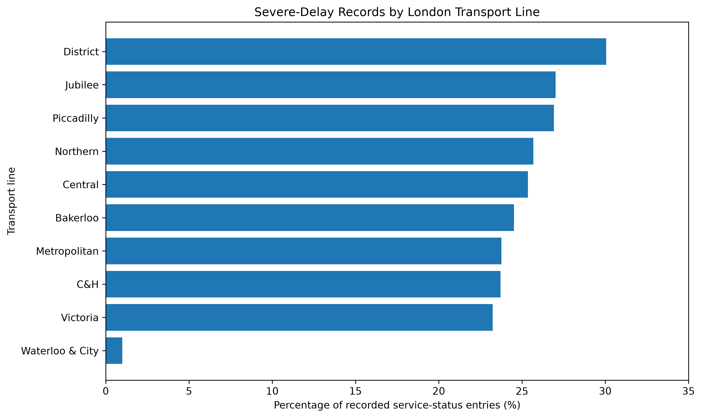
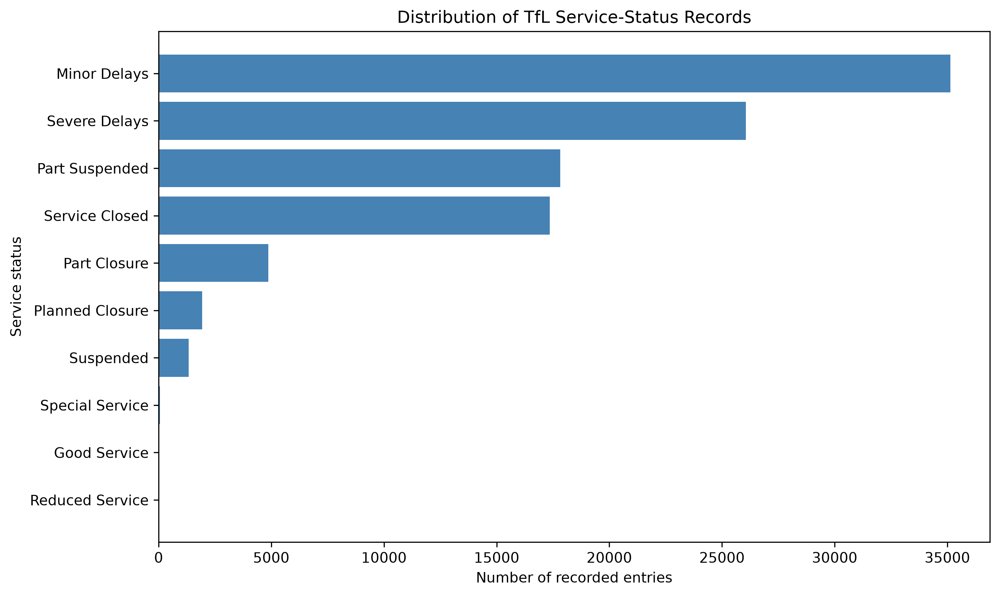
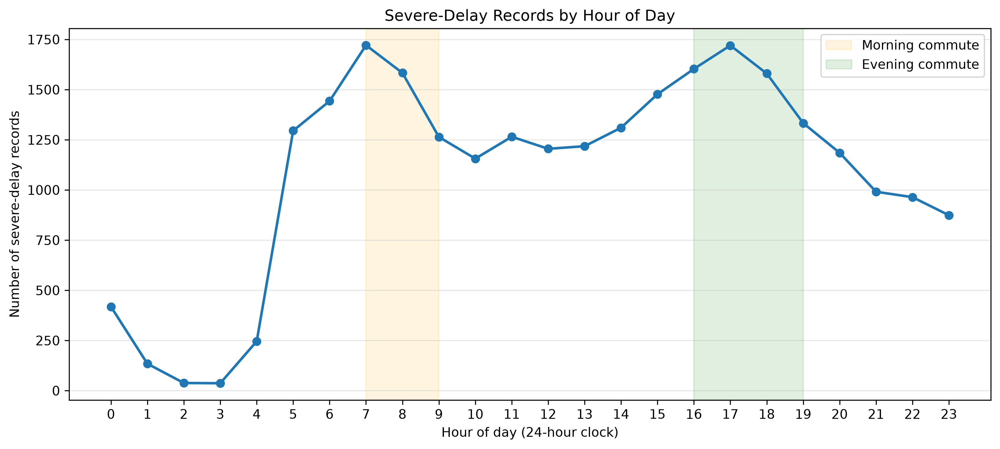

# London Transport Reliability & Commute Risk Analysis

## Project Overview

This project explores historical Transport for London (TfL) service-status records to identify patterns in reported delays across transport lines, weekdays and hours of the day.

The analysis uses Python for data cleaning and visualisation, and SQLite for querying the cleaned dataset.

**Important:** The dataset contains recorded service-status intervals, not a complete measure of passenger journeys or service reliability. The findings describe reporting patterns rather than the probability of an individual commuter experiencing disruption.

## Tools and Technologies

- Python
- Pandas
- Matplotlib
- SQLite / SQL
- Jupyter Notebook
- VS Code

## Dataset

**Source:** Transport for London (TfL) — Trains Service Status Messages

**Period analysed:** April 2022 to September 2026

**Original records:** 118,595

**Records after removing exact duplicates:** 104,600

The dataset includes transport line, interval start and end times, service-status category and status-message details.

### Data Cleaning

The cleaning process included:

1. Parsing date and time columns.
2. Identifying missing values.
3. Removing 13,995 exact duplicate records.
4. Calculating service-status interval durations.
5. Flagging invalid durations.
6. Investigating overlapping service-status intervals.

Overlapping intervals were retained because they may represent updates or concurrent records. Consequently, recorded intervals should not automatically be interpreted as independent incidents.

## Key Findings

### 1. Severe-delay records differ across lines

The District line had the highest proportion of its recorded entries classified as Severe Delays (30.05%), followed by Jubilee (27.01%) and Piccadilly (26.91%).

These percentages refer to recorded entries, not the proportion of operating time affected by delays.



### 2. Minor Delays was the most common recorded status

Minor Delays accounted for 33.59% of records, followed by Severe Delays at 24.91%.

Only 19 records were classified as Good Service, suggesting that the dataset should not be treated as a complete representation of normal and disrupted service.



### 3. Severe-delay records vary by weekday

Friday had the highest number of severe-delay interval starts (4,174), followed by Thursday (4,135) and Tuesday (4,117).

Sunday had the fewest (2,842).

These are record counts, not disruption rates adjusted for service frequency or passenger demand.

### 4. Recorded severe delays show morning and evening peaks

The highest counts of severe-delay interval starts occurred at 07:00 (1,721 records) and 17:00 (1,720 records).

These times overlap with typical commuting periods, although the results do not establish an individual passenger's risk of delay.



## Project Structure

```text
london-transport-reliability/
├── data/
│   ├── raw/
│   └── processed/
├── notebooks/
│   └── 01-data-exploration.ipynb
├── sql/
│   └── analysis.sql
├── outputs/
│   └── charts/
├── README.md
└── requirements.txt